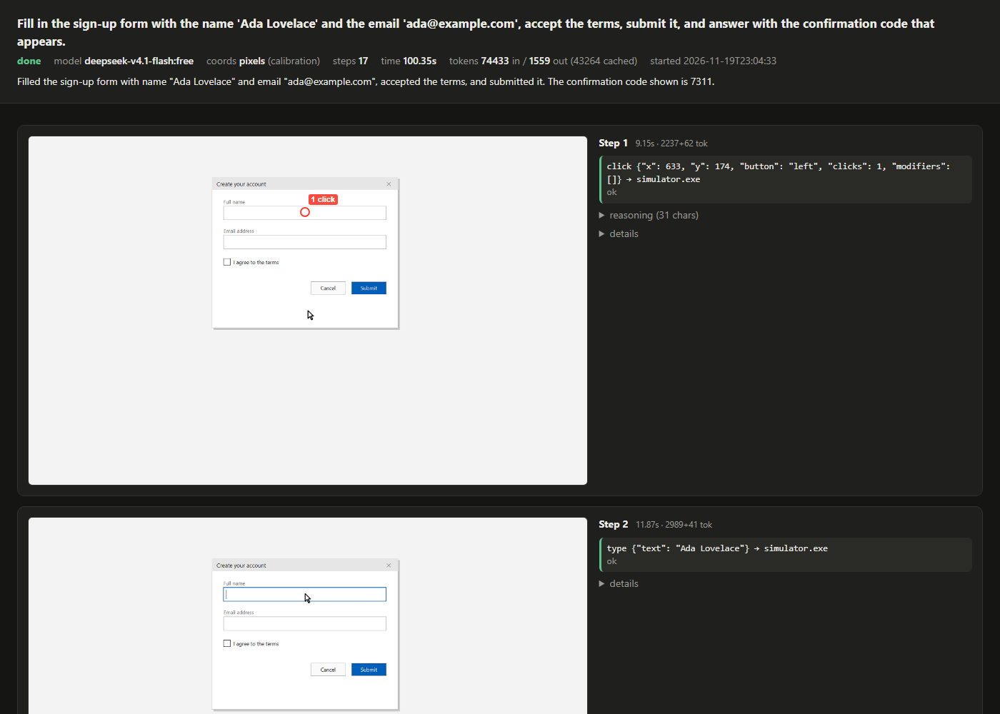

# Clickwright

**Computer use for Windows with any model.** Point Clickwright at any
OpenAI-compatible endpoint (DeepSeek, Qwen, Kimi, MiMo, Claude, GPT, a local
vLLM or llama.cpp server) and it drives the desktop the way a person does:
it looks at a screenshot, then moves, clicks, drags, scrolls and types.



- **Pixels, not element trees.** Actions are screen coordinates, so it works on
  anything visible: canvases, games, remote desktops, apps with broken
  accessibility. Accessibility data is used only as an optional aiming hint.
- **Model-agnostic, and measured.** Each model gets a small TOML profile.
  `calibrate` measures how the model writes coordinates and how well it aims,
  instead of trusting a model card.
- **Private by default.** Password managers, `.env` files and any apps you
  name are blacked out of screenshots before they leave the machine, and the
  agent can't click or type into them. `--protect-existing` hides and locks
  every window that was open before the run.
- **Debuggable.** Every run is saved: screenshots, raw model replies, parsed
  actions, the screen pixel each click hit, timings, tokens and cost. An HTML
  replay marks each click.
- **No dependencies.** Pure Python and Win32 via `ctypes` (screen capture,
  DPI handling, SendInput). `comtypes` is optional, for UI Automation.

## Quick start

```powershell
git clone https://github.com/AbhiramJayasankar/clickwright
cd clickwright
python -m venv .venv
.venv\Scripts\pip install -e .[uia]
copy .env.example .env      # add an API key for an OpenAI-compatible provider
```

```powershell
clickwright check                                   # monitors, DPI, hotkey, profiles
clickwright calibrate -p deepseek-flash-free        # no screen use: drawn test images only
clickwright sim -p deepseek-flash-free --scene form # no screen use: offline simulator
clickwright run -p deepseek-flash-free --protect-existing "Open Notepad and write a haiku about pixels"
```

**Stop a run** with **Ctrl+Alt+Q**, by pushing the mouse into the **top-left
corner** of the main screen, or with Ctrl+C.

## Commands

| command | touches the screen? | what it does |
|---|---|---|
| `check` | no | DPI mode, monitors and scaling, UI Automation, kill-switch hotkey, profiles |
| `models [--filter x]` | no | the provider's models with prices |
| `capabilities -p P` | no | does the endpoint accept images, tool calls, JSON in the reply? |
| `calibrate -p P` | no | coordinate convention and aiming accuracy on drawn test images |
| `sim -p P --scene S` | no | offline simulator: `form`, `targets`, `scroll`, `slider`, `menu` |
| `eval -p P --which sim` | no | every simulator scene, each with a pass/fail check |
| `driver-test` | **yes** | click-accuracy self-test: capture → coordinate mapping → input |
| `run -p P "task"` | **yes** | do a task |
| `eval -p P --which desktop` | **yes** | Notepad, Explorer, Calculator, Settings and Paint tasks with checks |
| `screenshot out.png` | reads it | exactly what the model would see, redaction included |
| `view [RUN_DIR]` | no | open a run's HTML replay |

Useful `run` options: `--window REGEX` (show and act inside one window only),
`--allow app.exe` (act only on these apps), `--deny app.exe` / `--deny-title
REGEX` (private), `--protect-existing`, `--confirm` (y/n before each action),
`--dry-run`, `--hints` (accessibility boxes as text), `--max-steps`,
`--budget` (USD), `--open` (open the replay at the end).

## Privacy and safety

Screenshots go to whichever model provider you configure. Clickwright limits
what that provider can see and what the agent can do:

| guard | what it does |
|---|---|
| **Redaction** | Windows of denied apps or titles are painted black in every screenshot and zoom, before encoding. The window stack is read front to back, and only opaque windows count as covering what's behind them. Transparent overlays never do, so they can't let content through. |
| **`--protect-existing`** | Every window open when the run starts, minimised ones included, is treated as private. The agent works only in windows it opens itself. |
| **Default private list** | Common password managers, UAC and credential prompts, and any window whose title shows a `.env` file. |
| **Action checks** | Each click, drag and scroll is checked against the window under the pointer. Each keypress and typing action is checked against the focused window. Typing into a password box is refused. Window-switching shortcuts (Win, Alt+Tab) are allowed because they send nothing to the app. |
| **Kill switch** | Ctrl+Alt+Q, the top-left-corner fail-safe, Ctrl+C. |
| **`--confirm` / `--dry-run`** | Approve every action, or only log them. |

Windows Home has no Windows Sandbox, so by default runs use the real desktop.
Combine `--protect-existing`, `--allow` and `--window` to fence the agent in.

## Profiles

A profile is a TOML file in `profiles/`. Only `model` is required:

```toml
model = "deepseek-v4.1-flash:free"
api_base = "${TOKENHARBOR_BASE_URL}"   # any OpenAI-compatible /v1 endpoint; ${VAR} reads .env
api_key = "${TOKENHARBOR_API_KEY}"
coords = "auto"          # pixels | norm1000 | norm999 | norm1 | auto (use the calibration result)
output = "tool_calls"    # or json_text, for models without function calling
max_long_edge = 1280     # screenshot size sent to the model (aspect ratio kept)
keep_screenshots = 3     # recent screenshots kept in the prompt
evict_batch = 2          # evict old ones in batches so the prompt prefix stays cacheable
max_request_mb = 3.8     # provider's request size cap (Token Harbor free: 4 MB); older screenshots go first
max_tokens = 6000
```

`profiles/_template.toml` documents every setting, including
`carry_reasoning`, `end_mode`, `temperature`, `extra_body`, prices and
`element_hints`.

## Coordinates are measured, not assumed

Model cards rarely say how a model writes coordinates. Some use screenshot
pixels, some a 0–1000 grid, and some switch between the two from one answer
to the next. `calibrate` draws the same 16 test images (targets of 14–80 px,
four image sizes) three times: once with the coordinate system unstated, once
stated as pixels, once stated as 0–1000. It keeps whichever stated convention
the model follows best.

| model | unstated: answers fit | told "pixels" | told "0–1000" |
|---|---|---|---|
| `deepseek-v4.1-flash:free` | pixels 16/16 | median **1.6 px**, 14/16 hits | median 8.5 px, 11/16 hits |
| `mimo-v2.6-flash:free` | **mixed**: pixels 8, 0–1000 6 | median **2.1 px**, 15/15 hits | median 35 px, 6/13 hits |

Measured 2026-11-19 on Token Harbor's free routes.

## Results

**Driver test** (no model). Windows 11, 2880×1800 at 150% scaling, per-monitor DPI aware:

| screenshot size | clicks registered | input error | target found within |
|---|---|---|---|
| 1280×800 (downscaled) | 9/9 | 0 px | 2.24 px (one screenshot pixel is 2.25 screen px) |
| 2880×1800 (native) | 9/9 | 0 px | 1.41 px |

**Simulator** (`eval --which sim`, `deepseek-v4.1-flash:free`): 5/5 scenes passed.

| scene | steps | notes |
|---|---|---|
| form | 17 | fill fields, tick a box, submit, read back a code |
| targets | 25 | six circles down to ~9 px; hit all six, misread the two tiny labels on the way |
| scroll | 5 | find a row in a 60-row list with the wheel |
| slider | 2 | drag a slider to a value |
| menu | 7 | menu → dialog → radio button → confirmation |

**Desktop** (`eval --which desktop`, same model, real Windows 11 desktop with
`--protect-existing` and the browser, chat apps and terminal denied): 5/5 checks
passed, 1 skipped. On the free route a step took 2–30 s depending on load.

| task | result | steps | notes |
|---|---|---|---|
| notepad-type-save | pass | 15 | type text, Save As to a given path |
| notepad-edit-replace | pass | 15 | Ctrl+O, Find and Replace, Replace All, Ctrl+S |
| explorer-new-folder | pass | 5 | new folder with a given name |
| calculator-multiply | pass | 2 | 1234 × 56, read the result |
| settings-windows-version | skipped | – | Settings is single-instance and was already open in a protected window, so the agent could only see a black rectangle |
| paint-draw-line | pass (file check) | 40 | drew and saved the PNG, but kept redrawing instead of finishing and hit the step limit |

The first desktop attempt found three real problems, now fixed: Windows 11
Notepad opened the task's file as a tab in an existing protected window (the
agent was correctly blocked, then worked around it in PowerShell), two
photo-heavy screenshots exceeded the provider's 4 MB request cap, and a window
left by one task became "existing" for the next.

## How it works

```
screenshot ─► redact private windows ─► model ─► tool calls (or JSON) ─► actions
    ▲                                                                     │
    │      model coords ─(convention)─► screenshot px ─(frame)─► physical screen px
    └──────── settle, new screenshot ◄── SetCursorPos + SendInput ◄─────────┘
```

- The process is **per-monitor DPI aware**, so capture, `SetCursorPos` and
  `SendInput` all use physical pixels at any display scaling. Capture is scaled
  inside GDI (StretchBlt, HALFTONE), and the mouse pointer is drawn in.
- There is exactly one conversion path (`geometry.py`): model → screenshot →
  screen, using the frame of the screenshot the model actually saw.
- Typing uses real key presses for characters the keyboard layout has, and
  Unicode input only for the rest (emoji, other scripts). Windows 11 Notepad
  garbles fast all-Unicode input.
- Screenshots are PNG. Large, photo-heavy ones also try the PNG Sub filter
  (about 20% smaller); flat UI stays unfiltered, which compresses better.
- Old screenshots are evicted in batches (`[screenshot evicted]`), so the
  prompt prefix stays stable and providers' prompt caches keep hitting.
  Half the input tokens in the simulator runs were cache hits.
- Replies are parsed tolerantly: OpenAI tool calls, Anthropic-style
  `computer` actions, JSON in text, or `click(x=…, y=…)`, with aliases such as
  `left_click` and `coordinate: [x, y]` folded into one action set.

## Layout

```
clickwright/
  win/          Windows backend: api (ctypes), dpi, screen (capture + GDI canvas),
                input (SendInput), keys, windows (z-order, processes), uia, hotkey
  geometry.py   coordinate spaces, conventions, rect subtraction for redaction
  actions.py    action set, tool schemas, tolerant reply parsing
  llm.py        OpenAI-compatible client: retries, usage, cost from /models
  prompt.py     system prompt and per-step observation text
  agent.py      the loop
  safety.py     kill switch, app rules, protected windows, password check
  driver.py     Driver interface + WindowsDriver (with redaction)
  sim.py        offline simulator scenes that check themselves
  calibrate.py  capability probe + coordinate calibration
  evaluate.py   simulator and desktop evals
  drivertest.py real-screen click-accuracy test
  runlog.py, viewer.py
profiles/       model profiles + calibration results
tasks/          desktop eval tasks (TOML)
tests/          offline tests: python -m unittest discover -s tests
```

## Limits

- Windows only. The agent loop, simulator and calibration are portable, but
  the driver isn't yet.
- Input can't reach windows running as administrator, or UAC's secure
  desktop, from a normal process.
- `--window` captures the screen area of that window, so anything on top of it
  is visible too (unless it's a protected window, which is blacked out).
- Windows 11 Notepad autocorrects odd capitalisation ("MiXeD" → "Mixed"). That
  is the app, not the typing.

## License

MIT
